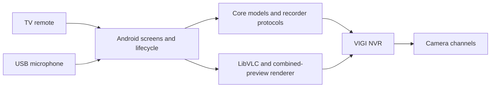

# Architecture

## Module boundary

`:core` is a Java 8 library with no Android dependencies. It owns profiles, camera discovery and groups, stream URLs, recorder protocols, auth / TLS, audio framing, channel conversion, viewport / layout geometry, cycle timing and the manual-alarm state machine. Its JVM tests use synthetic data and local fake TLS recorders. JSON-java is compile-only; Android supplies JSON at runtime.

`:app` owns Android Views, remote focus, Keystore / preferences, microphone permission and USB routing, LibVLC / OpenGL rendering, lifecycle coordination and dialogs. It depends on `:core`. `NativeActivity` still coordinates the screens and media lifecycle; extracting pure policies is preferred to rewriting that orchestration without hardware evidence.

## Models and connection configuration

`RecorderProfile` stores one recorder's host, accepted certificate, service ports, channel labels and explicit combined-grid mapping. It accepts channel identities 1–96, including sparse tables. `RecorderPorts` validates service ports. `RecorderStreams` builds credential-escaped live / replay / combined URLs and formats replay times in UTC. `CameraGroup` serialises ordered groups and prunes removed cameras atomically. `CameraNavigation` wraps manual camera changes within that order. `CompositeDraft` keeps named-cell edits, moves and resizing separate from saved data. `CompositeMapping` validates a complete, explicit source grid without modifying the original profile on failure.

`RecorderAddress` normalises a host or recorder HTTPS browser address while rejecting embedded credentials and arbitrary page paths. `RecorderSetup` separates address / identity verification from sign-in, asks for explicit fingerprint trust, then makes one advertised RSA/SHA256 login attempt and reads the camera table. `CameraDiscovery` only retains channel IDs and labels, with depth / work bounds and rejection of conflicting IDs. Unknown discovery shapes require manual configuration; there is no guessed channel offset. `RecorderServices` consistently resolves configured ports and the accepted certificate for controls and talk. No feature connects directly to a camera.

## Protocol boundaries

| Operation | Transport | Channel identity |
| --- | --- | --- |
| Live / replay | RTSP over TCP; default 554 | 1-based camera; main stream 1 / substream 2 |
| Combined preview | Same RTSP service | Channel 0 is composite only |
| Discovery / capabilities / lens | Pinned HTTPS; default 443 | Lens protocol uses 1-based string IDs |
| Manual alarm capability | Pinned HTTPS `chm_get_msg_alarm_list` | 0-based string ID |
| Manual alarm start / stop | Pinned HTTPS `manual_msg_alarm` | 0-based numeric ID; no PTZ forwarding |
| Talk | Pinned native TLS; default 8443 | 0-based numeric ID, converted inside transport |

`NvrWebControl` isolates session cookies, RSA/SHA256 challenge authentication and the different web command envelopes. `PinnedRecorderHttp` restricts paths, redirects, response sizes, dates and the exact approved certificate. `NativeNvrSession`, `VigiNativeAuth`, `DigestAuth` and `NativeTalkMux` implement the tested native talk protocol and 16 kHz mono PCMU transport. This protocol is not a universal or official VIGI SDK.

## Lifecycle and physical controls

- `AppLock` / `PatternSecret`: private salted pattern derivation, attempt delay and viewing lock. `PermissionSession` permits only a bounded return from an app-requested system permission prompt.
- `TalkController` / `UsbMicSource`: explicit user start, USB-only input, route checks, foreground authorisation and cancellation. Opening a panel never captures audio.
- `OpticalZoomController`: finite lens pulses followed by stop retries; arrow navigation does not move a lens.
- `ManualAlarmRun` / `AlarmController` / `AlarmSafety`: captured target, one start attempt, ten-second deadline, cancellation / stop retries and persistent unconfirmed-stop state. A stopped process cannot guarantee delivery of Stop; that limitation is surfaced in the UI and security documentation.
- `ControlTray` / `TrayDialog` and control panels share spacing and focus styles. Default alarm focus is Close; Start requires confirmation for the named camera. Stop recovery remains available for an unresolved app alarm even if a capability refresh fails.
- `ViewLayout` / `AutoCycle` are pure policies. Android eligibility guards suspend cycling while unlocked foreground viewing is interrupted, while user interaction rearms the interval.
- The Android viewing Activity enables an off-screen HWUI / texture-blending compatibility path on the tested `m7632` platform. This isolates the observed TV compositor quirk without changing recorder protocols or system-wide graphics settings. Screenshot output and physical panel output are separate validation requirements.
- `MosaicWall` decodes a configured recorder composite once and crops tiles using explicit mapping. It does not create a hidden decoder per tile.

## Extending compatibility

Add a sanitised fixture and tests before accepting a new response variant or protocol. Keep channel conversion in the corresponding transport; do not spread firmware offsets through UI code. Never guess authentication or silently weaken TLS. Eight / sixteen-camera selection opens explicit combined-preview setup rather than disabling menu rows. The one / four-camera layouts retain individual streams. Live Left / Right is intercepted only on the single-video surface; playback, focused controls, dialogs and zoom retain their own key behaviour.

A camera without a speaker / motor / alarm is not expected to offer that action. Unknown hardware must be recorded as untested rather than declared compatible.

## Camera-table changes and recovery

Camera identities remain strict, while an invalid combined-preview grid is recoverable. Missing, duplicate or out-of-range cells disable combined preview and set a review marker, preserving the recorder host, trusted certificate and camera table for individual streams. Discovery reuses known positions only for the same recorder and requires review when channel identities change. `ProfileStore` and account writes validate before persistence. Workspace camera refresh reads through the saved pinned connection; cancellation, failed discovery, loss of foreground authorisation or a changed source profile prevents application of that result.
